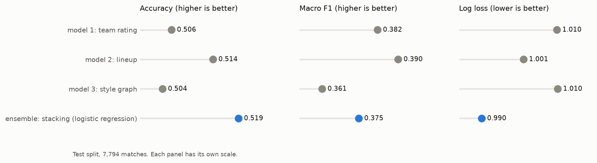
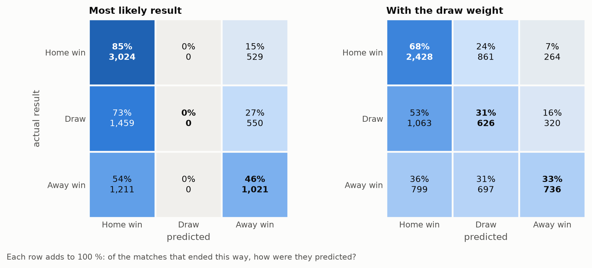
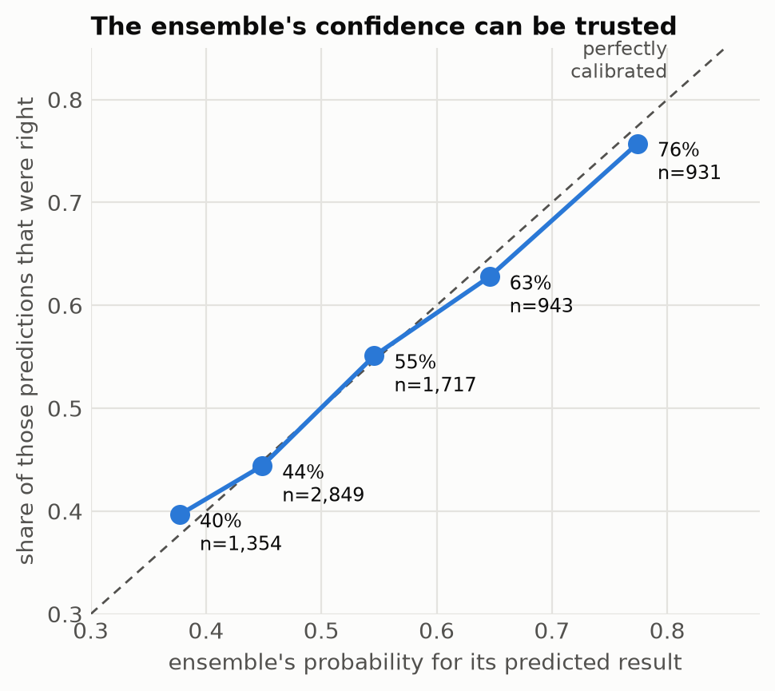
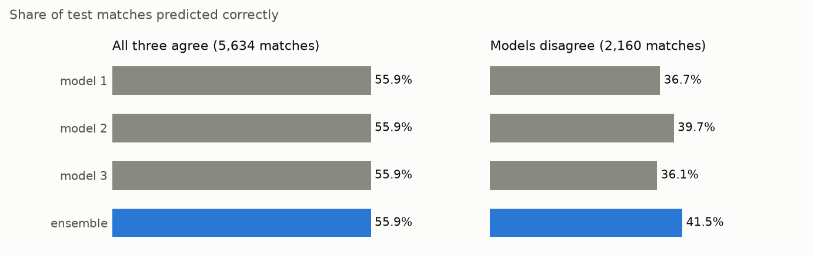

# Ensemble — combining Models 1, 2 and 3

```bash
python ensemble/ensemble.py   # ~10 s -> predictions/ensemble_test.parquet, metrics.json, figures/
python ensemble/agreement.py  # ~3 s  -> agreement.json, agreement_sample.csv, figures/agreement_accuracy.png
python ensemble/evaluate.py   # ~3 s  -> evaluation.json, figures/confusion_matrices.png, figures/calibration.png
python ensemble/predict.py "Barcelona" "Real Madrid CF"
```

## Inputs

Each model's `p_H`, `p_D`, `p_A` for all 25,979 matches, every one predicted out-of-sample. All three models use
the shared `datasets/split.parquet` (18,185 train / 7,794 test).

| Model | File | Training rows are… |
|---|---|---|
| 1 team rating | `model1_team_rating/outputs/pred_model1.parquet` | predicted from earlier training matches only |
| 2 lineup | `model2_lineup/outputs/pred_model2.parquet` | 5-fold out-of-fold (its draw weight is removed here) |
| 3 style graph | `model3/predictions/model3_*.parquet` | 5-fold out-of-fold |

The models agree only partly — correlation of P(home win) between them is 0.74–0.82 — which is what makes
combining them worthwhile.

## Method

Five combination rules, compared by 5-fold CV on the training split. The rule with the lowest CV log loss is refit
on the whole training split and scored once on the test split.

| Rule | CV accuracy | CV macro F1 | CV log loss | Test accuracy | Test macro F1 | Test log loss |
|---|---|---|---|---|---|---|
| Average (soft voting) | 0.519 | 0.374 | 0.989 | 0.517 | 0.373 | 0.993 |
| Geometric mean | 0.520 | 0.374 | 0.989 | 0.517 | 0.373 | 0.993 |
| Weighted average | 0.521 | 0.382 | 0.987 | 0.519 | 0.380 | 0.992 |
| **Stacking (logistic regression)** | **0.522** | 0.375 | **0.986** | **0.519** | 0.375 | **0.990** |
| Majority vote (hard voting) | 0.514 | 0.368 | – | 0.515 | 0.372 | – |

- **Stacking** fits a multinomial logistic regression on the nine log-probabilities, so it can learn that one
  model is better at one class than another.
- **Weighted average** weights: Model 2 0.55, Model 1 0.32, Model 3 0.14.

## Results (test split, 7,794 matches)



| | Accuracy | Macro F1 | Log loss |
|---|---|---|---|
| Model 1: team rating | 0.506 | 0.382 | 1.010 |
| Model 2: lineup | 0.514 | 0.390 | 1.001 |
| Model 3: style graph | 0.504 | 0.361 | 1.010 |
| **Ensemble: stacking** | **0.519** | 0.375 | **0.990** |
| Ensemble + draw weight 1.5 | 0.486 | **0.444** | 1.005 |
| Reference: Bet365 odds (6,800 matches with odds) | 0.532 | 0.388 | 0.974 |
| Ensemble on those same 6,800 matches | 0.524 | 0.380 | 0.985 |

- **The ensemble has the best accuracy and the best log loss**: +0.5 accuracy points and −0.011 log loss against the
  best single model. It is still 0.8 accuracy points behind the bookmaker on the matches that have odds.
- **Macro F1 does not improve without the draw weight.** Combining models sharpens the home/away call, so the
  unweighted ensemble never predicts a draw. With the draw weight (tuned on training CV) macro F1 is 0.444, above
  every single model's draw-weighted score (Model 2 0.438, Model 1 0.434).
- **Model 3 adds least** (weight 0.14): its results-graph PageRank overlaps with Model 1's ratings.

## A closer look at the ensemble

`evaluate.py` breaks the test-split result down further.



- **Without the draw weight the ensemble never predicts a draw** (5,694 home wins, 2,100 away wins). With it, 2,184
  draws are predicted; per-class F1 is then home 0.62, away 0.41, draw 0.30.



- **The probabilities are well calibrated.** Predictions made with up to 40 % confidence are right 40 % of the time,
  those above 70 % are right 76 % of the time.
- **Is the gain over single models more than noise?** Paired bootstrap on the test matches, 2,000 resamples:

  | Ensemble minus | Accuracy (95 % interval) | Log loss (95 % interval) |
  |---|---|---|
  | Model 1 | +0.013 (+0.007 to +0.020) | −0.019 (−0.024 to −0.015) |
  | Model 2 | +0.005 (−0.000 to +0.010) | −0.011 (−0.014 to −0.008) |
  | Model 3 | +0.015 (+0.008 to +0.022) | −0.020 (−0.024 to −0.015) |

  The log-loss gain is clear against every model. The accuracy gain over Model 2, the best single model, is not
  clearly distinguishable from zero.
- **Accuracy differs by league**: from 0.562 in the Netherlands to 0.452 in Poland, the league with the least
  complete data.

## Do the three models agree?

```bash
python ensemble/agreement.py   # -> agreement.json, agreement_sample.csv, figures/agreement_accuracy.png
```

Each model's prediction is its most likely class, on the 7,794 test matches.

| | Matches | Share |
|---|---|---|
| All three predict the same result | 5,634 | 72.3 % |
| Two against one | 2,064 | 26.5 % |
| Three different predictions | 96 | 1.2 % |

Pairwise agreement: Model 1 & 3 83.2 %, Model 1 & 2 80.3 %, Model 2 & 3 79.8 %. Model 2 (lineups) is the one that
most often differs; Models 1 and 3 both read past results.



- **Agreement is a confidence signal.** When all three agree they are right 55.9 % of the time; when they
  disagree, each single model is right only 36–40 %.
- **Disagreement marks genuinely close matches**, not model errors: the home team wins 38.5 % of them, against
  48.3 % where the models agree, and draws and away wins are both more common.
- **The ensemble earns its gain on the disagreements**: 41.5 %, above every single model there. Where the models
  agree it can add nothing.
- **It does not simply follow the majority.** In two-against-one matches:

  | Model that disagrees | Matches | That model right | Other two right | Ensemble sides with it |
  |---|---|---|---|---|
  | Model 1 | 584 | 30.7 % | 42.3 % | 9.1 % |
  | Model 2 | 853 | 36.6 % | 37.6 % | 44.2 % |
  | Model 3 | 627 | 29.0 % | 41.8 % | 1.1 % |

  When Model 1 or 3 stands alone it is usually wrong and the ensemble ignores it. When Model 2 stands alone it is
  right as often as the other two together, and the ensemble follows it almost half the time.
- **No model ever predicts a draw when all three agree** (4,502 home wins, 1,132 away wins, 0 draws), although
  25 % of those matches end level. This is the main source of error.
- Even when they predict the same result, the models' P(home win) differ by 0.13 on average.

`agreement_sample.csv` lists 15 randomly drawn test matches (seed 42) with each model's call.

## Team A vs team B (whole system)

```
$ python ensemble/predict.py "Hannover" "Mönchengladbach" --date 2014-02-01
Hannover 96 (home) vs Borussia Mönchengladbach (away) on 2014-02-01

  model 1: team rating   home  29.6%   draw  30.3%   away  40.1%   -> away win
  model 2: lineup        home  41.8%   draw  24.1%   away  34.1%   -> home win
  model 3: style graph   home  27.6%   draw  24.1%   away  48.3%   -> away win
  ------------------------------------------------------------------------------
  ensemble (stacking)    home  35.6%   draw  28.3%   away  36.0%   -> away win

  the models disagree: a close match
  prediction: away win   (with draw weight 1.5: draw)
```

`predict.py` calls the three models' own `predict.py` for the same date and feeds their probabilities to the
stacking model. It takes about 15 s. Both teams must play in the same league. On macOS it finds the OpenMP library
that LightGBM needs by itself, so no `brew install libomp` is required.

## Limits

- The gain over the best single model is small; all three models see mostly the same thing — which team is stronger.
- Draws stay hard: without the draw weight no draw is predicted, and with it draw F1 is still the lowest of the three classes.

## Output

`predictions/ensemble_test.parquet` — `match_api_id`, `p_H`, `p_D`, `p_A`, `prediction` (highest probability),
`prediction_draw_weighted` (after the draw weight).
