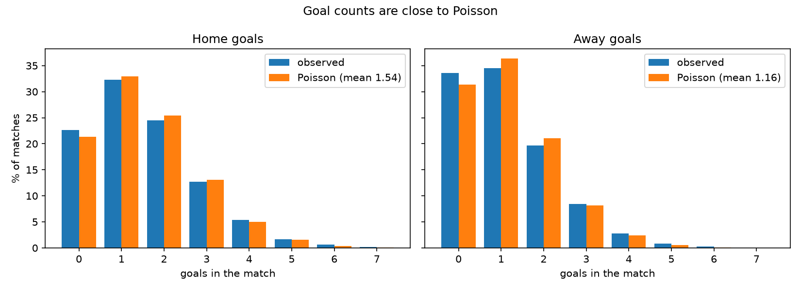
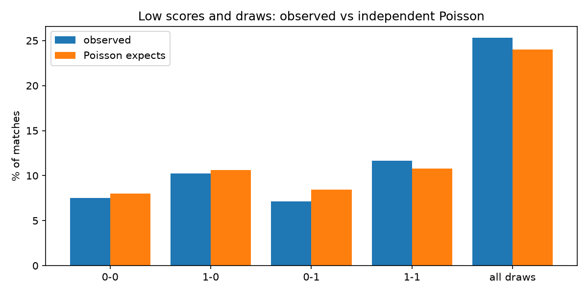
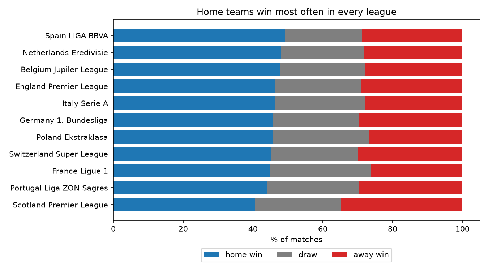
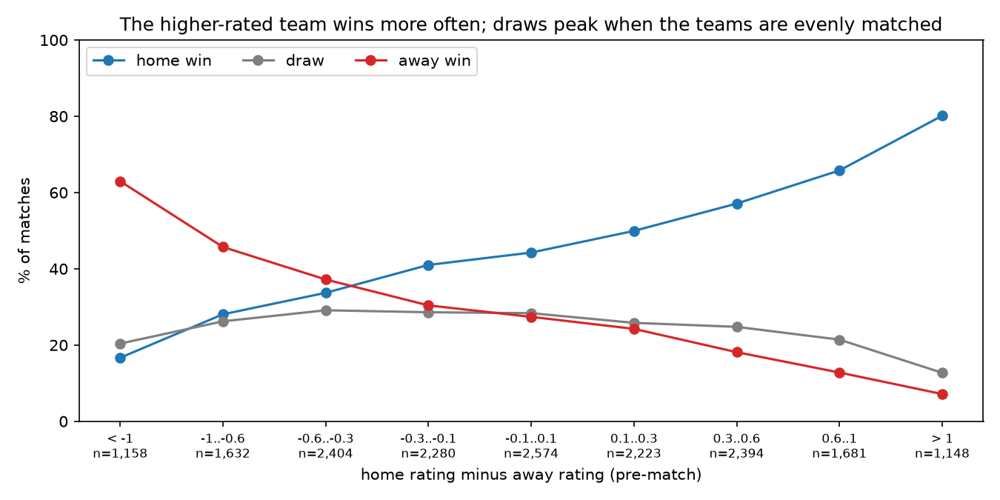
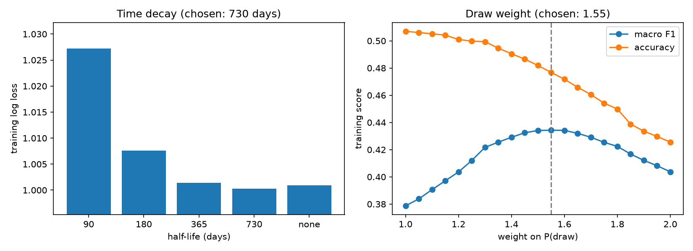
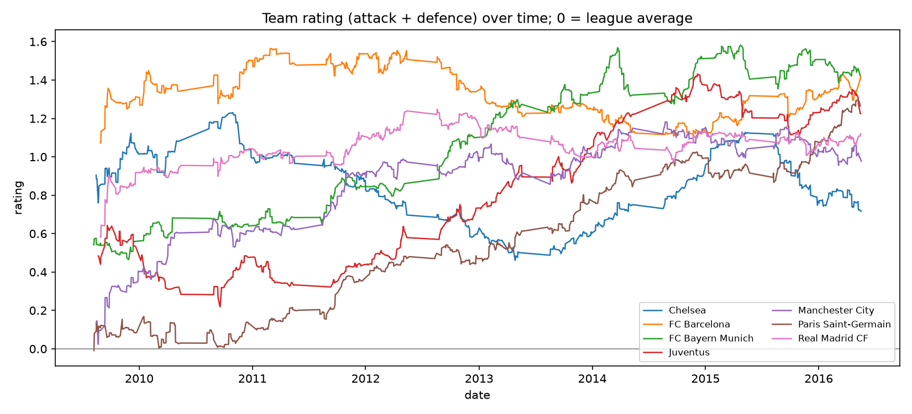

# Model 1 — team rating (Poisson regression)

**Question:** from team results alone, how strong is each team, and who wins when team A plays team B?

```bash
pip install -r requirements.txt
python model1_team_rating/train.py     # ~7 min -> outputs/metrics.json, pred_model1.parquet, ratings.parquet, figures/
python model1_team_rating/eda.py       # ~2 s   -> figures/eda_*, outputs/eda_summary.md (needs train.py outputs)
python model1_team_rating/predict.py "Barcelona" "Real Madrid CF"
```

| File | Purpose |
|---|---|
| `rating.py` | Poisson / Dixon-Coles model: fit one league, score grid, refit on every match day |
| `train.py` | tune time decay and draw weight, ablation, test scores, predictions for the ensemble |
| `eda.py` | do goals behave like the model assumes? (training split) |
| `predict.py` | team A (home) vs team B (away) |

## Data and split

- Input: `matches` only — date, league, the two teams, full-time goals, result. Team level only: no lineups or
  player attributes (Model 2), no FIFA tactics (Model 3). These columns have no missing values.
- Split: the shared `datasets/split.parquet` (random 70:30, `random_state=42`) → 18,185 train / 7,794 test.
- **Leakage control.** The split is random, so test matches are scattered through time. Ratings used for a match
  on day *d* are fitted only on *training* matches dated strictly before *d*. No test result is ever used for
  fitting. Training rows are therefore predicted out-of-sample too, and are used for tuning.

## Method

Every team has an **attack** and a **defence** rating. For home team *i* against away team *j*:

```
expected home goals  λ = exp(c + h + attack_i − defence_j)
expected away goals  μ = exp(c     + attack_j − defence_i)
```

`c` is the league's goal level and `h` its home advantage. Goals are Poisson, so the probability of every score
0–10 : 0–10 follows; summing below, on and above the diagonal gives P(home win), P(draw), P(away win).
A team's overall **rating = attack + defence** (0 = league average).

| Step | Detail |
|---|---|
| Fit | Poisson regression (GLM, log link) on two rows per match (home goals, away goals), sklearn `PoissonRegressor` |
| Per league | ratings are relative to the league, so each league is fitted separately |
| Refit | on every match day (8,255 league-days), from training matches of the last 3 years before that day |
| Time decay | match weight = 0.5 ^ (age in days / half-life) |
| Ridge (L2, α = 0.001) | makes the ratings identifiable and pulls teams with little history toward the league average |
| Dixon-Coles ρ | multiplies the 0-0, 1-0, 0-1, 1-1 probabilities by a correction factor; fitted after attack/defence |
| Burn-in | fewer than 50 training matches in the window → training class rates (253 test matches, early 2008/09) |

## EDA (training split)



- **Goal counts are close to Poisson** (every count within 2 points). Home teams score 1.54 per match, away teams 1.16.



| Score | Observed | Poisson expects |
|---|---|---|
| 0-0 | 7.5 % | 8.0 % |
| 1-0 | 10.3 % | 10.6 % |
| 0-1 | 7.1 % | 8.4 % |
| 1-1 | 11.7 % | 10.8 % |
| all draws | 25.3 % | 24.0 % |

- **Independent Poisson under-predicts draws** by 1.3 points: 1-1 is more common and 1-0 / 0-1 less common than
  expected. A negative ρ corrects exactly this, and ρ came out negative in 10 of 11 leagues.



- **Home advantage exists in every league** but differs: home win rate 49 % in Spain, 41 % in Scotland — hence a
  separate home term per league.



- **The rating separates strong and weak teams.** When the home rating is more than 1 above the away rating, the
  home team wins 80 %; more than 1 below, 17 %.
- **Draws peak (~29 %) when the teams are evenly matched** — around an away rating slightly above the home
  rating, where home advantage levels the match — and fall to 13 % for big gaps.

## Tuning (training split)



| Half-life | 90 d | 180 d | 365 d | **730 d** | none |
|---|---|---|---|---|---|
| Training log loss | 1.0272 | 1.0076 | 1.0014 | **1.0003** | 1.0009 |

Short memories hurt: a team's strength changes slowly, so a 2-year half-life works best. The draw weight
(see below) was tuned on the same rows: **1.55**.

## Results (test split, 7,794 matches)

| | Accuracy | Macro F1 | Log loss |
|---|---|---|---|
| Baseline: always home win (training class rates) | 0.456 | 0.209 | 1.066 |
| Poisson, no time decay | 0.504 | 0.373 | 1.011 |
| Poisson + time decay (half-life 730 d) | 0.505 | 0.374 | 1.010 |
| **Dixon-Coles + time decay (final)** | **0.506** | **0.382** | **1.010** |
| Final + draw weight 1.55 | 0.471 | 0.434 | 1.026 |
| Reference: Bet365 odds (6,800 test matches with odds) | 0.532 | 0.388 | 0.974 |

- Each step adds a little; ρ adds most to macro F1 (+0.8 points) because it moves probability onto draws.
- **Class imbalance.** Without help the model almost never predicts a draw. P(draw) is multiplied by the draw
  weight and the probabilities renormalised; this trades 3.4 points of accuracy for 5.2 points of macro F1.
  Per-class F1 with the weight: home 0.60, away 0.40, draw 0.30.
- From results alone, the model reaches the same log loss as Model 3 (1.010) and is 2.6 accuracy points behind
  the bookmaker.



## Team A vs team B

`predict.py` fits the league's ratings from training matches before the given date (default: the day after the
later team's last match), with the half-life and draw weight from `outputs/metrics.json`.

```
$ python model1_team_rating/predict.py "Barcelona" "Real Madrid CF"
FC Barcelona (home) vs Real Madrid CF (away) on 2016-05-15
  Spain LIGA BBVA, ratings from 820 training matches
  home: attack +0.81  defence +0.61  rating +1.42  (rank 1 of 20)
  away: attack +0.88  defence +0.24  rating +1.12  (rank 2 of 20)
  expected goals: 2.51 - 1.32
  P(home win) 63.2%   P(draw) 18.2%   P(away win) 18.6%
  most likely scores: 2-1 (9.0%), 3-1 (7.5%), 1-1 (7.3%), 2-0 (6.9%), 2-2 (6.0%)
  prediction (draw-weighted): home win
```

The first team plays at home. Teams can be given by long name, short name, a unique part of the name, or
`team_api_id`; `--date YYYY-MM-DD` sets the match date. Both teams must play in the same league.

## Limits

- **No cross-league comparison.** Teams only meet within their league, so a rating means "vs this league's average".
- **Goals only.** Injuries, rotation, transfers and coach changes are seen only after they change results.
- **Promoted teams start at the league average**, although they are usually weaker; ratings in the first
  season (2008/09) swing widely because there is little history.
- **Only 70 % of past results are used** (training matches), so ratings are noisier than with every result.
- **The split is random**, so scores may be slightly optimistic compared with forecasting future seasons.
- ρ is fitted after attack/defence rather than jointly as in the original Dixon-Coles paper — simpler, slightly
  different estimates.

## Outputs for the ensemble

| File | Rows | Content |
|---|---|---|
| `outputs/pred_model1.parquet` | 25,979 | `match_api_id`, `set` (train / test), `p_H`, `p_D`, `p_A`, `lambda_home`, `lambda_away`, `has_rating`; train rows predicted from earlier training matches only (out-of-sample); probabilities **without** the draw weight so they stay calibrated |
| `outputs/ratings.parquet` | 173,196 | `team_api_id`, `league`, `date`, `attack`, `defence`, `rating` on every match day |
| `outputs/metrics.json` | — | chosen half-life and draw weight, ρ per league, test scores, confusion matrix |
