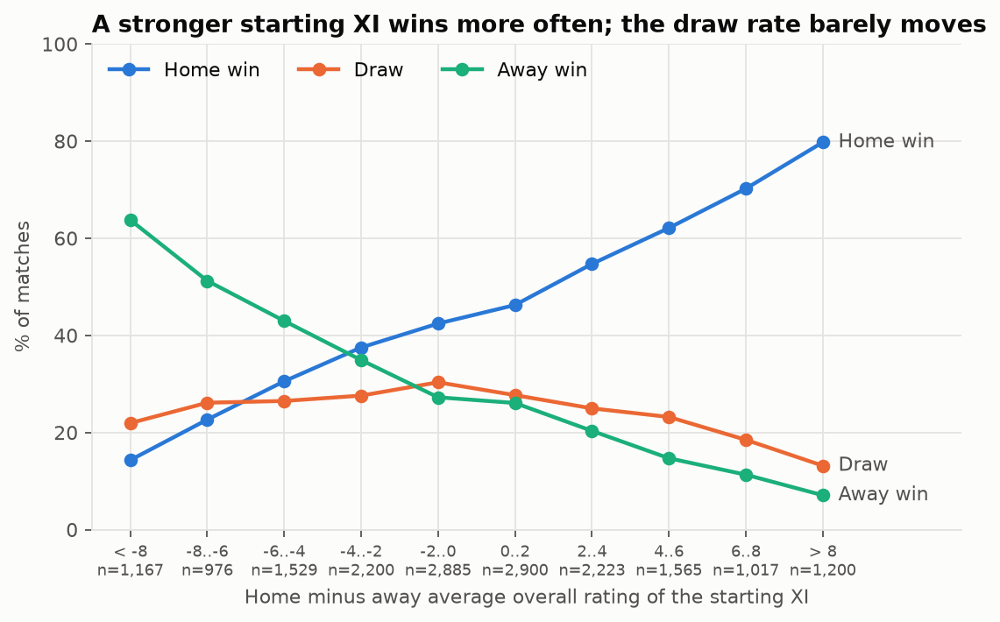
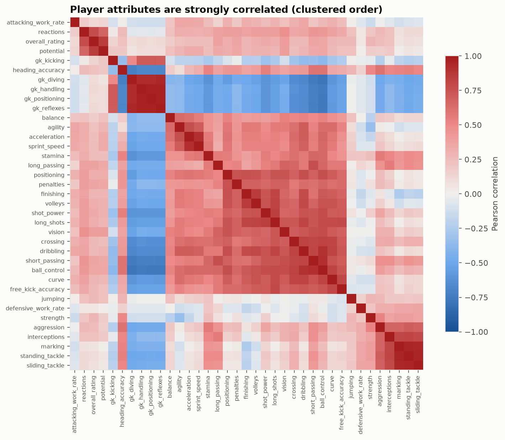
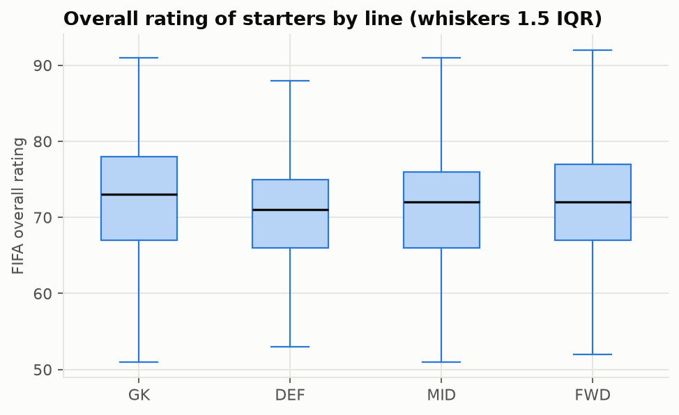
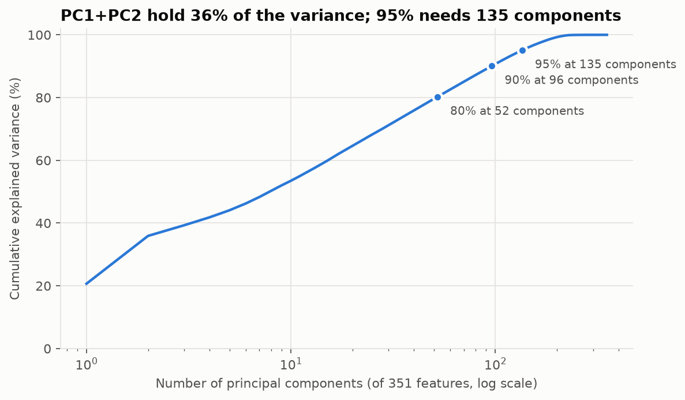
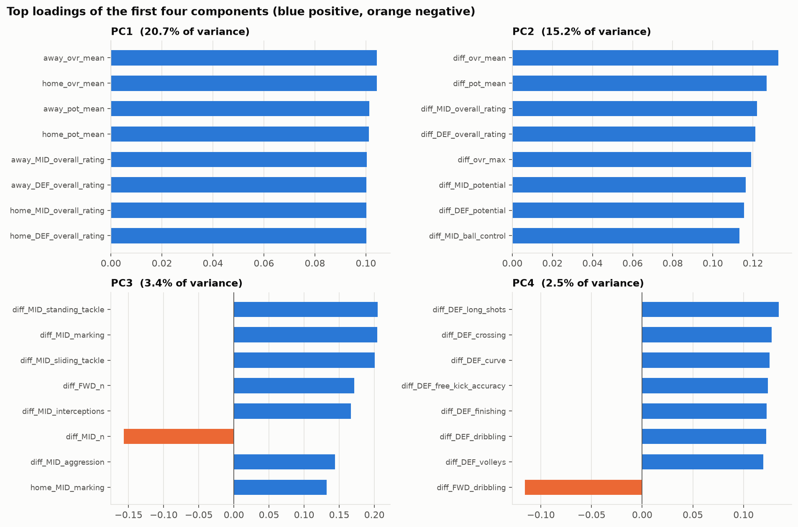
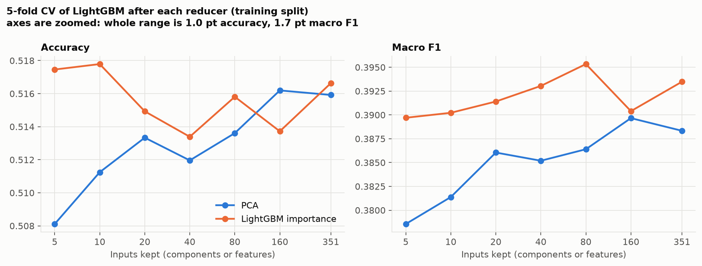

# Model 2 — lineup evaluation

**Question:** given the two starting lineups, which team's XI is better, and does that decide the match?

```bash
pip install -r requirements.txt     # macOS also needs: brew install libomp (for LightGBM)
python model2_lineup/eda.py            # ~10 s   -> figures/eda_*, outputs/eda_summary.md
python model2_lineup/pca_selection.py  # ~10 min -> figures/pca_*, figures/selection_curve.png, outputs/pca_*
python model2_lineup/train.py          # ~3 min  -> outputs/metrics.json, pred_model2.parquet, model2.joblib
python model2_lineup/predict.py "Barcelona" "Real Madrid CF"
```

| File | Purpose |
|---|---|
| `features.py` | lineups → one row per match (351 features) and the 70:30 split |
| `eda.py` | ratings vs results on the training split |
| `pca_selection.py` | PCA vs feature selection by CV |
| `train.py` | final model, test scores, predictions for the ensemble |
| `predict.py` | team A (home) vs team B (away) |

## Data and split

- Input: `lineups` (starters with FIFA attributes joined as-of the match date), `players` (age, height, weight),
  target `matches.result` (H / D / A). Every input is known before kick-off, so no feature leaks the result.
- Split: random 70:30, `random_state=42`, over all 25,979 matches → 18,185 train / 7,794 test.
  All EDA, PCA and model selection use the training split only; the test split is scored once.
- 758 matches have no lineup and 3,847 have an incomplete one. Their features stay NaN.

## Features (351)

Each player is assigned to a line from the back-to-front pitch position (`pos_y`): GK, DEF, MID, FWD
(falling back to the lineup slot when the position is missing). Per team:

| Group | Features |
|---|---|
| Whole XI | number of players; overall rating mean / max / min / std; potential mean / max; age, height, weight, left-foot share |
| GK | the 5 goalkeeping attributes and overall rating |
| DEF / MID / FWD | mean of 32 outfield attributes per line (work rates encoded low = 0, medium = 1, high = 2) |
| Formation | players per line, e.g. 4-4-2 → DEF 4, MID 4, FWD 2 |

Home features, away features, and home − away differences give 117 × 3 = 351 columns.

## EDA (training split)



- **The stronger XI wins more often.** When the home XI averages more than 8 rating points above the away XI, the
  home team wins 78.8 %; when it is more than 8 below, it wins 13.4 %.
- **The draw rate barely moves** (14–30 % in every bin). Lineups say who is stronger, not whether the match
  will be level, so draws are the hardest class.
- Classes: H 45.7 %, A 28.8 %, D 25.5 %.



- **Player attributes are strongly correlated**: mean |r| = 0.38, and 85 of 1,369 attribute pairs exceed
  |r| = 0.7 (e.g. the tackling group, the goalkeeping group, ball skills). The feature set is redundant, which
  motivates dimension reduction.



- Median overall rating is similar across lines (GK 73, DEF 71, MID 72, FWD 72).

## Dimension reduction (training split)




| Component | Variance | Meaning (largest loadings) |
|---|---|---|
| PC1 | 20.7 % | overall level of *both* teams (home and away rating means) — i.e. league quality |
| PC2 | 15.2 % | home − away rating gap — which team is stronger |
| PC3 | 3.4 % | midfield defending gap (tackling, marking, interceptions) |
| PC4 | 2.5 % | ball-playing defenders gap (passing, crossing, shooting skills of the DEF line) |

80 / 90 / 95 % of the variance needs 52 / 96 / 135 components.

PCA was compared with feature selection by LightGBM gain importance, keeping k = 5 … 351 inputs,
LightGBM on top, 5-fold CV. Each reducer is fitted inside the folds.



| Reducer | Best k | CV accuracy | CV macro F1 |
|---|---|---|---|
| PCA | 80 components | 0.514 | 0.391 |
| Feature selection (LightGBM importance) | 40 features | 0.514 | 0.397 |

- **All settings land within 0.6 points of accuracy and 1.4 points of macro F1.** Five inputs already give
  almost the full score: the signal is the one-dimensional strength gap (PC2), and the other 350 columns are
  mostly redundant with it.
- Feature selection is slightly better on macro F1 than PCA, and its inputs stay interpretable. The most
  important features are `diff_ovr_mean`, `diff_pot_mean` and the midfield and defence rating gaps.

## Model and results

Three tree-based pipelines, compared by 5-fold CV on the training split:

| Pipeline | CV accuracy | CV macro F1 |
|---|---|---|
| LightGBM on all 351 features | 0.513 | 0.393 |
| Impute + scale + PCA (95 % variance) + LightGBM | 0.514 | 0.390 |
| **Feature selection (above-median importance, 177 features) + LightGBM** | **0.514** | **0.397** |

**Class imbalance.** Without help, the model rarely predicts a draw. The draw probability is multiplied by a weight
tuned on the out-of-fold training predictions to maximise macro F1 (weight = 1.5), then the three probabilities
are renormalised.

**Test split (7,794 matches), final model:**

| | Accuracy | Macro F1 |
|---|---|---|
| Unweighted probabilities | 0.525 | 0.397 |
| Draw weight 1.5 | 0.488 | 0.442 |

Per-class F1 with the draw weight: home 0.62, away 0.43, draw 0.28. The weight trades 3.6 points of accuracy for
4.5 points of macro F1.

## Team A vs team B

`predict.py` assumes each team fields the XI and formation of its most recent match before the given date, takes
every player's latest FIFA attributes on or before that date, and runs the final model.

```
$ python model2_lineup/predict.py "Barcelona" "Real Madrid CF"
FC Barcelona (home) vs Real Madrid CF (away) on 2016-05-15  [model: lgbm_select]
  expected XI from: home 2016-05-14, away 2016-05-14
  average overall rating: home 86.5, away 85.2
  P(home win) 47.3%   P(draw) 15.7%   P(away win) 37.0%
  prediction (draw-weighted): home win
```

Teams can be given by long name, short name, a unique part of the name, or `team_api_id`; `--date YYYY-MM-DD` sets
the match date.

## Limits

- **FIFA ratings are a proxy.** They are game ratings updated a few times a season, not measured match form.
- **Lineups are only known about an hour before kick-off.** `predict.py` has to guess the XI from the previous
  match, so injuries and rotation are missed.
- **Lineups cannot see draws.** Nothing in a lineup separates a level match from a narrow win, so draw F1 stays low.
- **The split is random**, so the training set contains matches from after some test matches. The features are all
  pre-match, so this does not leak results, but scores may be slightly optimistic compared with forecasting future
  seasons.

## Outputs for the ensemble

| File | Rows | Content |
|---|---|---|
| `outputs/pred_model2.parquet` | 25,979 | `match_api_id`, `set` (train / test), `p_H`, `p_D`, `p_A`; train rows are 5-fold out-of-fold, all with the draw weight applied |
| `outputs/model2.joblib` | — | fitted final model, feature list and draw weight |
| `outputs/metrics.json` | — | CV and test scores, confusion matrix |
