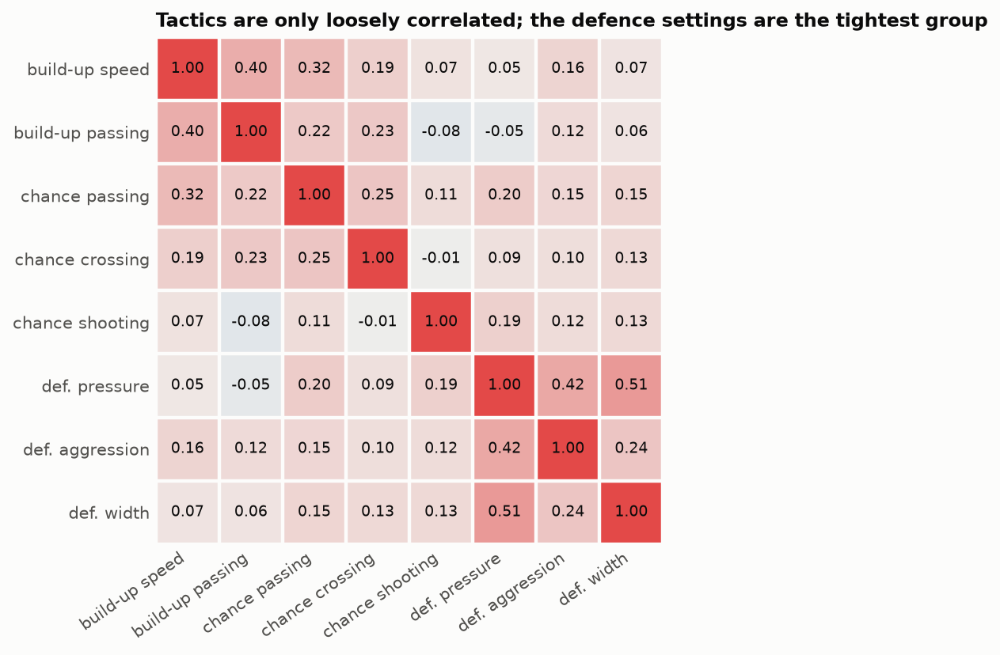
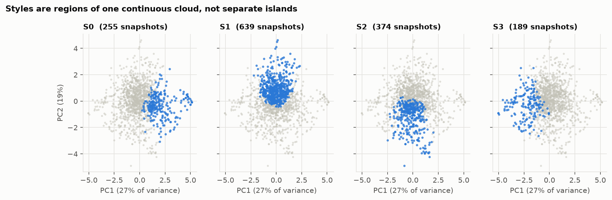
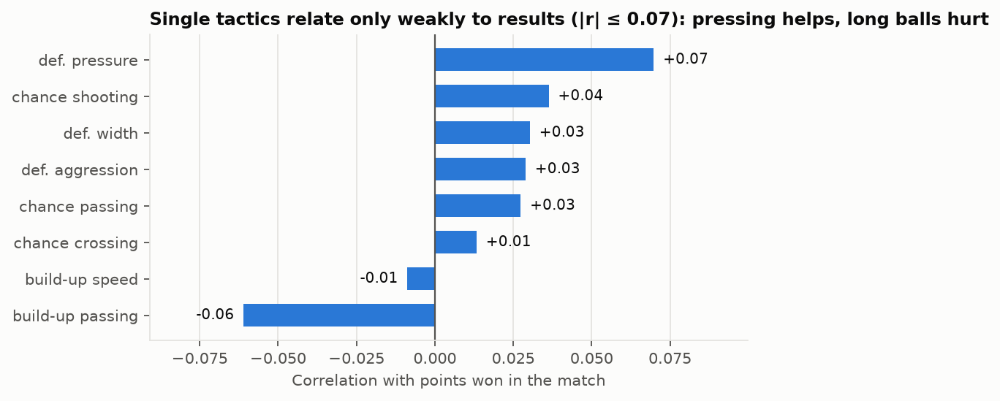
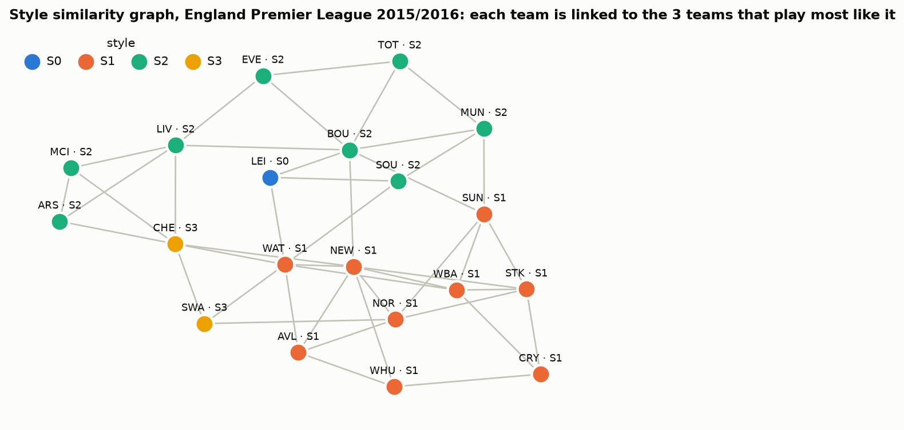
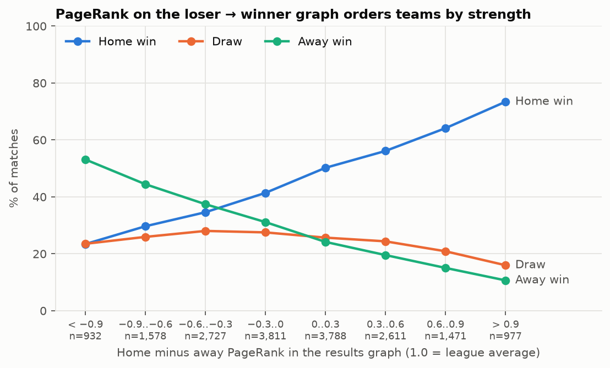
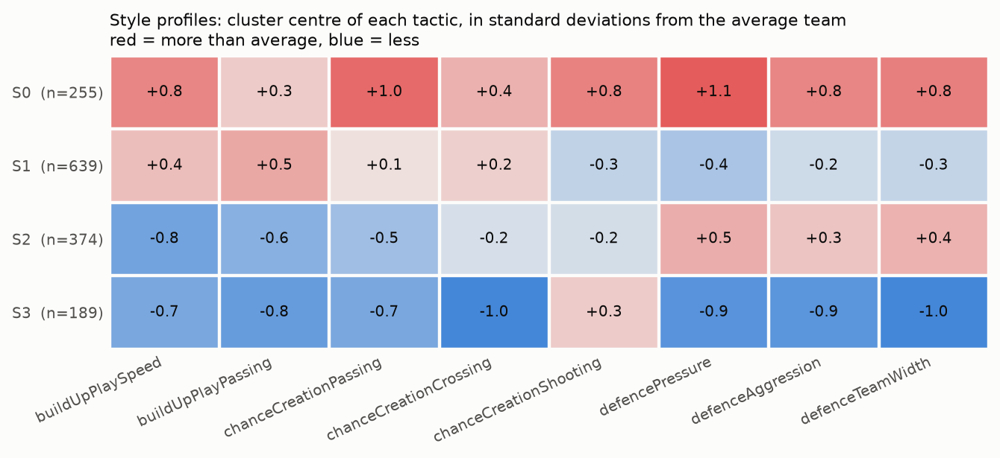
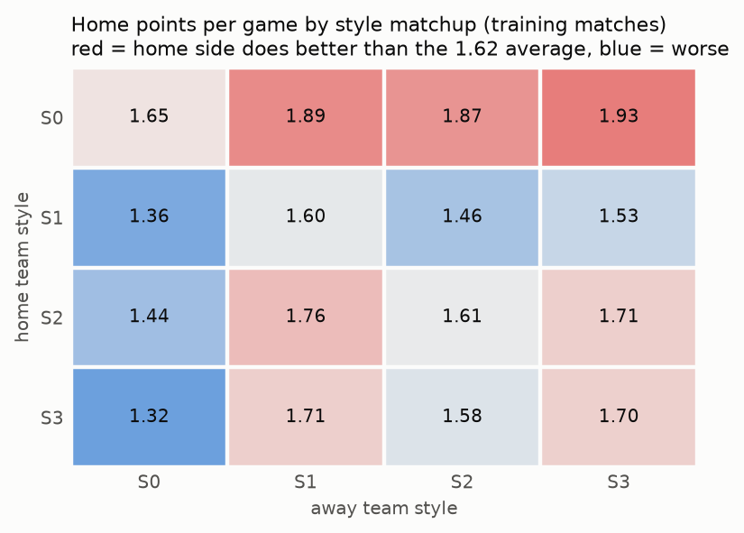

# Model 3 — team play style (graph)

**Question:** does a team that plays style X tend to beat a team that plays style Y?

```bash
python model3/build_features.py   # ~40 s -> features.parquet, styles.parquet, styles.joblib
python model3/train.py            # ~20 s -> predictions/, metrics.json, model3.joblib, figures/style_*
python model3/eda.py              # ~5 s  -> figures/eda_*, eda_summary.md
python model3/predict.py "Barcelona" "Real Madrid CF"
```

| File | Purpose |
|---|---|
| `build_features.py` | tactics → styles → three graphs → one feature row per match |
| `train.py` | gradient boosting, ablation, test scores, predictions for the ensemble |
| `eda.py` | what the tactic data and the graphs look like |
| `predict.py` | team A (home) vs team B (away) |

## EDA

Input: `team_attributes` — 1,457 tactic snapshots of 288 teams, one per team per year (2010–2015), eight settings
on a 20–80 scale. Anything that uses match results is computed on the training split only.



- **The eight tactics carry mostly separate information**: mean |r| = 0.17. The tightest pairs are defence pressure
  with defence width (0.51) and with aggression (0.42), and build-up speed with build-up passing (0.40).
  There is little redundancy to remove, so all eight are kept.



- **Styles are regions of one continuous cloud.** On the first two principal components (47 % of the variance)
  the four K-means styles sit side by side with no gaps between them.
- **A team's style is not fixed**: it keeps the same style from one yearly snapshot to the next only 59 % of the time.



- **A single tactic says little about results**: the strongest correlation with points won is +0.07 (defence
  pressure) and −0.06 (long build-up passing). Style matters through combinations and matchups, if at all.



- **The similarity graph groups teams that play alike.** In the 2015/16 Premier League (20 teams, 44 edges,
  density 0.23, average clustering 0.44) the possession sides (S2: Arsenal, Man City, Liverpool, Tottenham…) form one
  neighbourhood and the direct sides (S1) another; Leicester is the only S0 team.



- **PageRank on the results graph tracks strength**: the home team wins 73 % when its PageRank is more than 0.9
  above the away team's and 23 % when it is more than 0.9 below.
- **Coverage**: no match has a style in 2008/09, 34 % in 2009/10, and 93–96 % from 2010/11 on.

## Method

1. **Style.** Each team's 8 FIFA tactic settings (build-up speed/passing, chance-creation passing/crossing/shooting,
   defence pressure/aggression/width), taken as of match day, are standardised and clustered with K-means.
   K is chosen by silhouette score (K = 4).
2. **Graphs.**

   | Graph | Nodes | Edges | Features |
   |---|---|---|---|
   | Style matchup | the 4 styles | home style → away style, weighted by past H / D / A rates | `matchup_p_*`, `style_rank_*` (PageRank of a style) |
   | Style similarity | teams of a league | 3 nearest neighbours in tactic space | degree centrality, clustering coefficient, density, `*_ppg_vs_similar_to_*` |
   | Results | teams of a league | loser → winner, last 365 days | `pagerank_*`, `weakrank_*`, `results_density` |

   `home_ppg_vs_similar_to_away` is the feature closest to the question: the points per game the home team took, over
   the last two years, from the away team and its style neighbours.
3. **Model.** Gradient boosting (`HistGradientBoostingClassifier`) on the graph features plus the raw tactics and
   formation line counts. Missing values are left to the trees.

**Leakage control.** The split is random, so test matches are scattered through time. Every graph that uses match
outcomes is built only from *training* matches dated strictly before the match being described.

## Results (30 % test split, 7,794 matches)

| | Accuracy | Macro F1 | Log loss |
|---|---|---|---|
| Baseline: always home win | 0.456 | 0.209 | 1.066 |
| Style only, no graph | 0.470 | 0.289 | 1.044 |
| + style graphs | 0.487 | 0.324 | 1.030 |
| **+ results graph (final)** | **0.504** | **0.361** | **1.010** |
| Final with `class_weight="balanced"` | 0.443 | 0.429 | 1.040 |
| Reference: Bet365 odds (6,800 matches with odds) | 0.532 | 0.389 | 0.974 |

- Each graph adds signal on top of raw style.
- Without class weighting the model almost never predicts a draw; weighting trades 6 points of accuracy for 7 points of macro F1.

## Findings and limits




- **S0 (high press, fast and risky attacking play) is the dominant style**: at home it takes 1.87–1.93 points per game
  from the other three styles, and every other style scores below average against it.
- **Style is confounded with team strength.** Strong clubs are the ones that can afford to press high, so part of the
  S0 effect is squad quality, not tactics. The results-graph PageRank is there to separate the two.
- **The styles are not well-separated clusters** (silhouette 0.13): tactics vary continuously, so the 4 styles are a
  convenient discretisation rather than natural groups.
- **25 % of matches have no style** (tactics start in February 2010); for those the model falls back on the results graph.

## Team A vs team B

`predict.py` appends the hypothetical match to the real ones and runs the same feature builder, so the graphs are
built exactly as in training (training matches before the date). Each team is assumed to use the formation of its
last match. Both teams must play in the same league.

```
$ python model3/predict.py "Barcelona" "Real Madrid CF"
FC Barcelona (home) vs Real Madrid CF (away) on 2016-05-15
  Spain LIGA BBVA
  home: style S2 (+defenceAggression, −chanceCreationPassing);  results-graph PageRank 1.62 (1.00 = league average)
  away: style S0 (−chanceCreationCrossing, +defenceTeamWidth);  results-graph PageRank 1.5 (1.00 = league average)
  style matchup, S2 at home vs S0 away, over 639 earlier matches: home 40.1%  draw 23.8%  away 36.1%
  points per game against the opponent and teams that play like it: home 2.38 (8 matches), away 2.45 (11 matches)
  P(home win) 53.6%   P(draw) 23.1%   P(away win) 23.3%
  prediction: home win
```

The style matchup alone gives the home side only 40 %, but the model says 54 %: both teams' PageRank is far above
the league average, and the final call rests on all the features together, not on style alone.

## Outputs for the ensemble

| File | Rows | Content |
|---|---|---|
| `predictions/model3_test.parquet` | 7,794 | `match_api_id`, `p_H`, `p_D`, `p_A` for every test match |
| `predictions/model3_train_oof.parquet` | 18,185 | 5-fold out-of-fold probabilities for every training match, for training a stacking model |

Probabilities come from the unweighted model so they stay calibrated.
